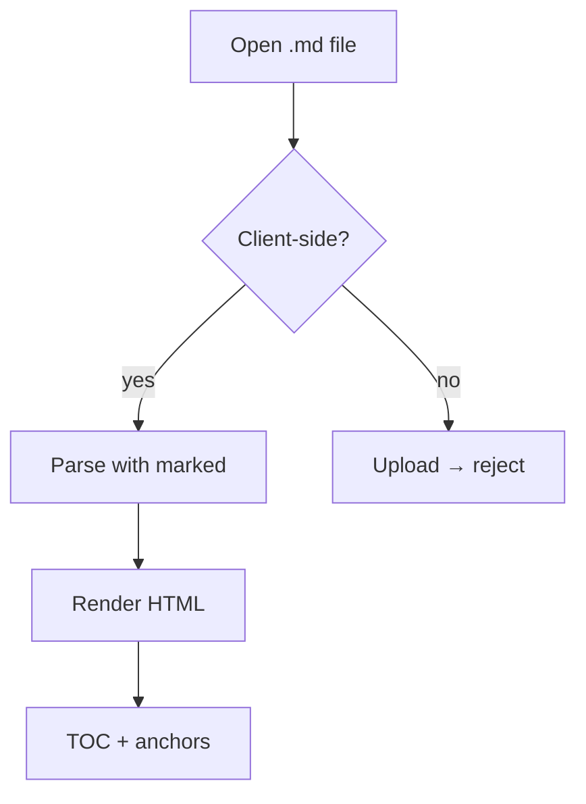
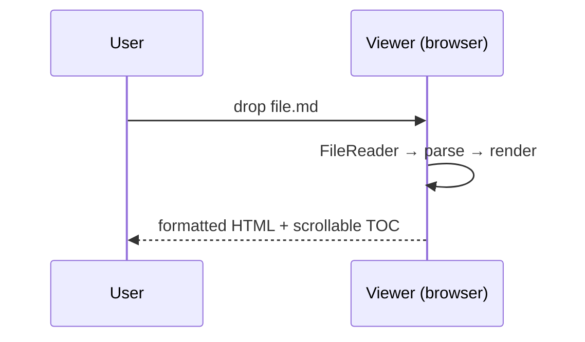
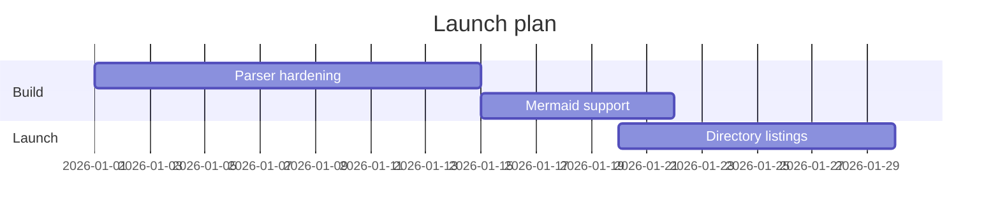
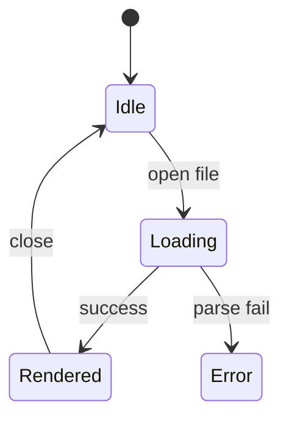
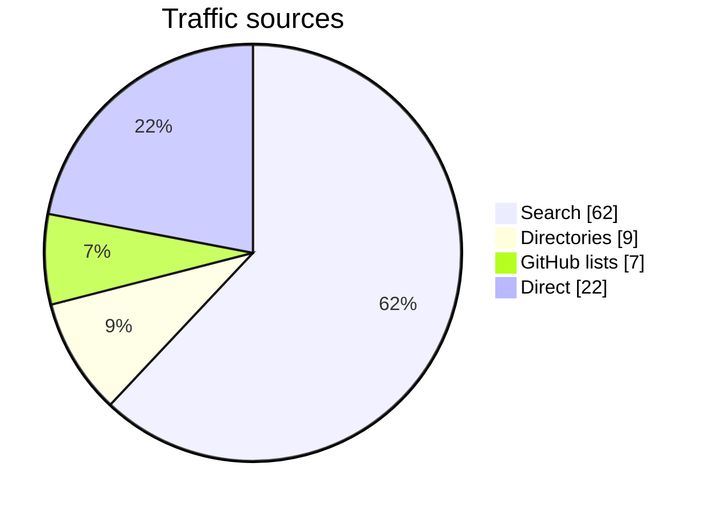

<!-- Expected: Mermaid flowchart/sequence/gantt/state/pie; renderers without Mermaid show a code block instead — that is acceptable fallback -->

# Mermaid Diagrams

## Flowchart

## Sequence

## Gantt

## State

## Pie

